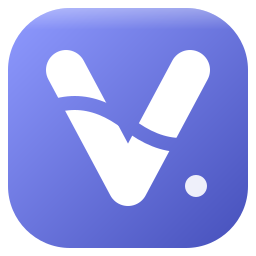

# Vibewall



Живые обои для Windows 10/11 на Rust: видео, GIF, картинки и звук на
рабочем столе за значками. Своя библиотека, загрузка своих файлов и
открытые ресурсы с «вайбами» — неон, лоу-фай, космос, киберпанк,
ретровейв, Токио, дождь.

## Возможности

- Видео, анимация, картинки — на каждый монитор своё или одно на все.
- Звук видео (с одного монитора, без эха), спектр для музыки, фоновая
  музыка по кругу.
- Библиотека: кнопка или перетаскивание, превью кадра.
- Открытые ресурсы: Pexels, Pixabay, NASA, Openverse, Викисклад; фильтры
  по типу, качеству (Full HD / 4K) и «коротким петлям»; автор и лицензия
  сохраняются.
- Пауза при полноэкранных приложениях, трей, автозапуск, восстановление
  после перезапуска проводника и смены мониторов.
- Устойчивый запуск: OpenGL по умолчанию, запасной wgpu, сторож окна,
  журнал и окна с ошибками.

## Источники

| Источник | Что | Ключ | Лицензия |
|---|---|---|---|
| Pexels | видео до 4K, фото | бесплатный | Pexels License |
| Pixabay | видео, анимации-петли | бесплатный | Pixabay License |
| NASA | космос: видео, фото | не нужен | общественное достояние |
| Openverse | картинки, музыка | не нужен | Creative Commons (своя у файла) |
| Викисклад | видео, GIF, картинки, звук | не нужен | свободные лицензии |

Ключи пользователь вводит в программе. Для своих сборок можно вшить ключи
по умолчанию: переменные `VIBEWALL_PEXELS_KEY` / `VIBEWALL_PIXABAY_KEY`
при сборке (в CI — секреты репозитория).

Только источники с официальным API и лицензией, разрешающей такое
использование. Никаких трекеров, «мастерских» чужих программ и сайтов с
перезаливами.

## Как устроено

| Файл | Что делает |
|---|---|
| `src/desktop.rs` | Окно за значками: `0x052C` в Progman, классическая раскладка (WorkerW) и Windows 11 24H2+ (слоистое дочернее окно Progman под `SHELLDLL_DefView`) |
| `src/mpv.rs` | libmpv, подгружается при запуске (`libmpv-2.dll`), опции обоев и музыки |
| `src/engine.rs` | Окно и mpv на каждый монитор, музыка, пауза, слежение за проводником |
| `src/library.rs` | Библиотека и настройки в `%LOCALAPPDATA%\Vibewall` (+ переезд со старой папки) |
| `src/online.rs`, `src/sources/` | Поиск по источникам, скачивание с прогрессом |
| `src/thumbs.rs` | Превью через mpv `vo=image` |
| `src/ui.rs`, `src/theme.rs` | Панель на egui в стиле из `DESIGN.md` |
| `assets/` | Иконка (SVG → ICO/PNG), манифест Windows |
| `packaging/` | README, лицензии, установщик Inno Setup, описание релиза |

Подсмотрено в открытых проектах: [Lively](https://github.com/rocksdanister/lively),
[weebp](https://github.com/Francesco149/weebp), [BackScene](https://github.com/probablyxs/backscene).

## Сборка

```
cd vibewall
cargo build --release
```

Рядом с `vibewall.exe` нужен `libmpv-2.dll` из `mpv-dev-x86_64-*.7z`
([shinchiro/mpv-winbuild-cmake](https://github.com/shinchiro/mpv-winbuild-cmake/releases)).

Из Linux: `cargo build --release --target x86_64-pc-windows-gnu` (нужен
`gcc-mingw-w64-x86-64`). `cargo test` проверяет переносимую часть, с
установленным libmpv — и настоящий mpv; `VIBEWALL_LIVE=1 cargo test live`
— живые запросы к источникам без ключа.

Иконка: `assets/icon.svg` (16/24 точки — `icon-small.svg`), ICO и PNG
собираются `rsvg-convert` + ImageMagick.

Релиз собирает `.github/workflows/vibewall.yml` при изменениях в
`vibewall/`: архив и установщик, тег `vibewall-v<version из Cargo.toml>`.

## Перед выпуском

- Поднять `version` в `Cargo.toml`.
- Подпись кода: без сертификата Windows SmartScreen предупреждает о
  неизвестном издателе. Для подписи нужен сертификат (OV/EV или Azure
  Trusted Signing) и шаг `signtool` в workflow.

## Лицензии

mpv — GPL (сборка shinchiro), исходники на mpv.io. Сторонние компоненты
— `packaging/THIRD-PARTY.txt`.
